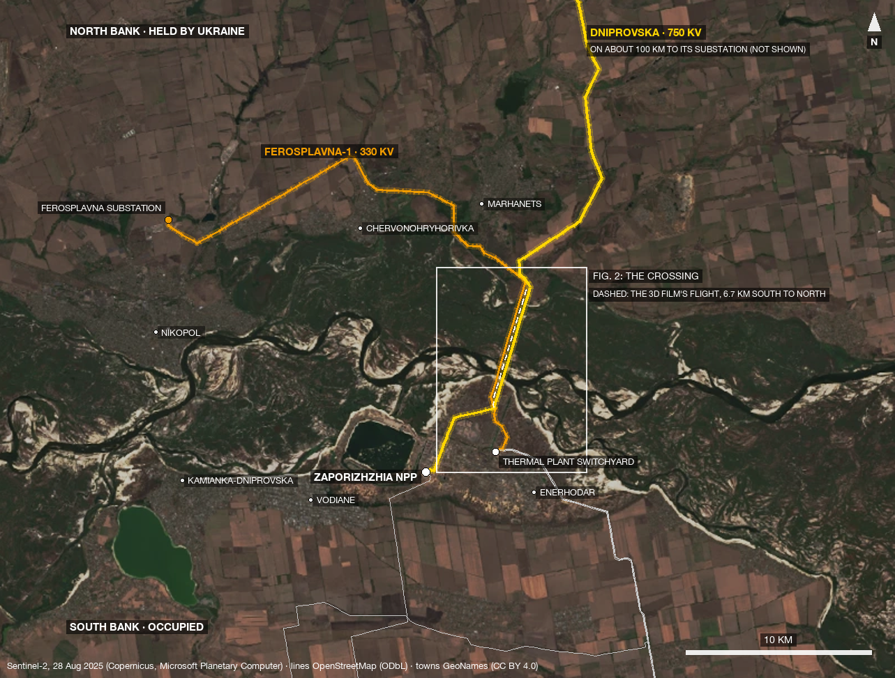
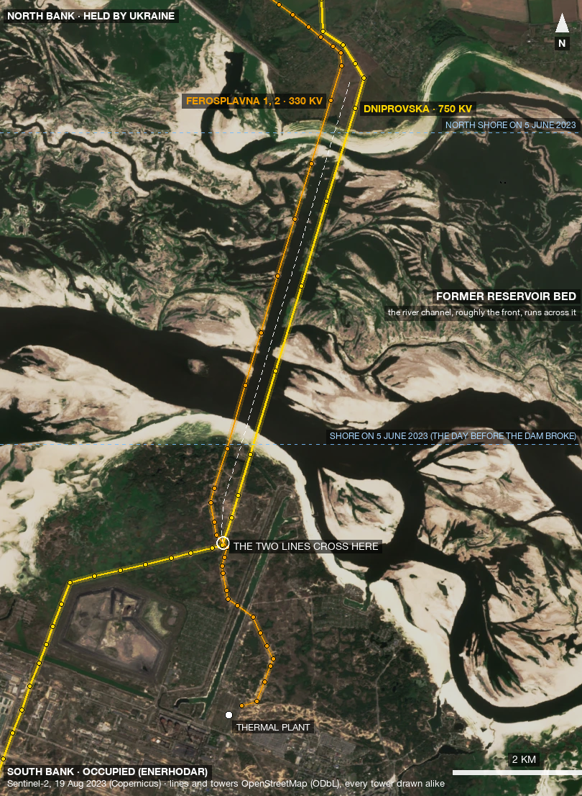
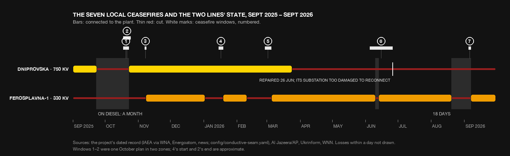
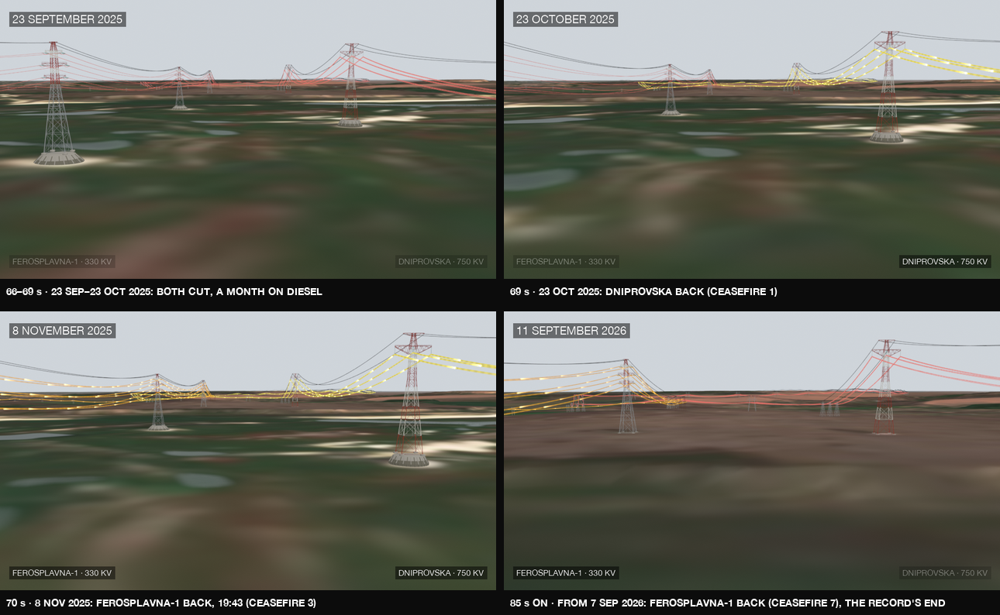

# The ceasefire for one span

Since October 2025 the war on the Dnipro has stopped seven times, each time for a few hours or days, in a zone about 1.5 km across, so that crews could mend one of two power lines. Then a line was cut again. These two lines are the occupied Zaporizhzhia nuclear plant's last links to the grid: the 750 kV **Dniprovska** line and the 330 kV **Ferosplavna-1** line. They are the same two lines your 3D film flies between. The truces sit inside its record from **66 s to 86 s** of `3D-film.mp4`.

The framing in one sentence: **the most negotiated objects on this front are two wires, and the people who mend them have no names.**

This note gives the map, the dates, one repair told hour by hour, the gap in the human record, and a starting point for the film. It draws on the three earlier reports and their notes. Facts seen only in search summaries are marked *(snippet)*.

---

## 1. Where it is

*Figure 1. The two lines leave the occupied south bank (bottom) and cross the drained Kakhovka reservoir to the held north bank. Dniprovska (bright yellow) runs on about 100 km to its substation, which is not shown because it is an active target. Ferosplavna-1 (deeper yellow) turns west along the bank to the Ferosplavna substation near Nikopol, about 34 km from its start. The white box is figure 2; the dashed line inside it is the 3D film's flight. Other lines from the plant are thin grey. Sentinel-2, 28 August 2025.*

The key positions:
- **Where the lines start.** Dniprovska leaves the ZNPP's 750 kV switchyard. Ferosplavna-1 leaves the switchyard of the Zaporizhzhia thermal plant in Enerhodar, about 4 km east of the plant.
- **Where they meet.** The lines cross each other **3.4 km east and 2.6 km north of the reactors**, on the south bank. From there they run north side by side, **about 365 m apart**.
- **The reservoir crossing.** On 5 June 2023, the day before the dam was destroyed, the water reached from **3.9 to 8.3 km north** of the plant along the lines. Wikipedia puts the crossing's centre at 47.5648 N, 34.6454 E.
- **The towers.** Dniprovska crosses on 5 towers: four of 126 m and a 100 m anchor in the middle. Ferosplavna crosses on 7 towers of 90–100 m. All stand on concrete caissons that now sit on the dry bed.
- **The landfall.** The lines come ashore about 9 km north of the plant, in the Marhanets hromada, between Marhanets and Nikopol. The villages nearest the landfall are Maryivka and Dobra Nadiia.
- **The front.** It follows the Dnipro, which now runs as a channel through the drained bed.

These positions come from the project's own survey (OSM towers; `scenes/crossing3d/survey.json`) and the [Wikipedia article on the crossing](https://en.wikipedia.org/wiki/Enerhodar_Dnipro_Powerline_Crossing).

*Figure 2. The crossing, Sentinel-2, 19 August 2023, two months after the drainage. Every mapped tower is drawn the same way, and none is marked as damaged or repaired. Dashed blue lines show where the shores were the day before the dam broke. The white dashed line is the 3D film's flight: 6.7 km from where the lines cross to the north bank.*

### Is it the same two lines as the 3D film?

Yes.

| In the 3D film | Which line | Notes |
|---|---|---|
| The right-hand row, label "DNIPROVSKA · 750 KV" | Dniprovska, 750 kV, from the ZNPP | One circuit, three glowing phases |
| The left-hand row, label "FEROSPLAVNA-1 · 330 KV" | Ferosplavna 1 and 2 (Л-243/Л-244), from the thermal plant | Both circuits share the crossing towers. The film colours the row by **Ferosplavna-1**'s state, the circuit the IAEA reports on |

The flight starts where the lines cross (2.6 km north) and ends past the north shore (9 km north). It therefore passes over the crossing towers themselves and over the first 1.3 km of the occupied south bank.

### Where the repairs were, as published

The sources describe repair sites only roughly, and this note keeps them that way.

| Repair | Published location | Where that falls on the map |
|---|---|---|
| Dniprovska, Oct 2025 | "in an area under Russian control" ([Al Jazeera/AP](https://www.aljazeera.com/news/2025/10/18/zaporizhzhia-nuclear-plant-repairs-begin-in-ukraine-as-ceasefire-zones-set)) | The occupied side |
| Ferosplavna-1, Oct 2025 | "in Ukrainian-controlled territory" (same) | Somewhere along the roughly 25 km of Ferosplavna-1 on the held side |
| Ferosplavna-1, Nov 2025 | "about three kilometres from the site perimeter" *(snippet, IAEA Update 327)*; extra damage "about 1.8 km" from the thermal plant's switchyard, "closer to the plant… outside the initially agreed zones" *(snippet, Interfax-Ukraine; IAEA)* | On the **south bank**, between the thermal plant and the shore: the stretch where the 3D film begins |
| Dniprovska, Jun 2026 | "tall towers near the demarcation line on the Dnipro River" ([Ukrinform](https://ukrinform.net/rubric-economy/4130748-iaea-secures-ceasefire-for-repairs-to-power-line-supplying-znpp.html)); "high pylons across the Dnipro" ([WNN](https://world-nuclear-news.org/articles/substation-damage-stopping-zaporizhzhia-power-line-reconnection-says-iaea)) | **The crossing itself**, the towers the 3D film flies past. Reuters adds a second work site at the thermal plant's switchyard ([via Internazionale](https://www.internazionale.it/ultime-notizie-reuters/2026/06/26/iaea-says-repairs-completed-on-key-power-line-at-zaporizhzhya-nuclear-plant)) |
| Ferosplavna-1, Aug–Sep 2026 | Cut "after military activity on the northern side of the Dnipro River" ([WNN](https://www.world-nuclear-news.org/articles/local-ceasefire-in-place-for-zaporizhzhia-power-line-repairs)) | Anywhere along the north-bank part of the line, which is tens of kilometres long. It is not necessarily near the landfall |

**Safety rule for the film:** say which bank, or "the crossing", and never which tower. *(Amended with the user: repair and damage sites may be shown as a general region, a stretch of line or an area at least about 3 km across and never finer than the source, as in the right-hand column above; still never a tower, a pin, coordinates or a crew's position. NEXT.md I5.)*

---

## 2. The seven truces

*Figure 3. The two lines' reported states from the project's record (`config/conductive-seam.yaml`), with the truce windows numbered. Losses lasting under a day are left out. Bars show a line connected, thin red shows it cut, and grey shading marks time on diesel.*

| # | Window | Line | What happened | In `3D-film.mp4` |
|---|---|---|---|---|
| 1 | 18–23 Oct 2025 | Dniprovska | The first local truce, after the plant had been **a month on diesel** (from 23 Sep). Reconnected 23 Oct | 66–69 s |
| 2 | from 18 Oct 2025 | Ferosplavna-1 | A second zone in the same October plan. Further damage closer to the plant delayed reconnection | (none) |
| 3 | 7–8 Nov 2025 | Ferosplavna-1 | Demined on Friday, repaired on Saturday, **reconnected at 19:43**. The plant's first backup line in six months | 70 s |
| 4 | mid-Jan 2026 | Ferosplavna-1 | Cut 2 Jan; "a Ukrainian team" repairs it; back 19 Jan ([Liga](https://news.liga.net/en/politics/news/repair-of-a-backup-power-line-near-zaporizhzhia-npp-begins-photo)) | 72–73 s |
| 5 | 27 Feb–5 Mar 2026 | Ferosplavna-1 | Cut 10 Feb; 23 days off ([UP](https://www.pravda.com.ua/eng/news/2026/03/05/8024118)) | 74–76 s |
| 6 | 5–26 Jun 2026 | Dniprovska | "Technical specialists from both Ukraine and Russia" repair the crossing's tall towers. Grossi called it the hardest of the six *(snippet, NEI)*. The line was fixed but **can't be switched on**: its substation, more than 100 km away, was too damaged | (not shown: the line stays cut) |
| 7 | 5–7 Sep 2026 | Ferosplavna-1 | After **18 days on diesel**, with fuel down to "little more than a week". Reconnected 7 Sep. This is the record's last state: one line of ten | 85 s |

On the numbering: WNN counted six truces by late June 2026 and the seventh in September. The sources found describe October as one plan in two zones, which makes seven. The IAEA's own list was not readable (its pages block automated access), so check this numbering before captioning it on screen.

---

## 3. One span, hour by hour: 7–8 November 2025

This is the cleanest single case:
- **May 2025.** Ferosplavna-1 has been cut since 7 May. For six months the plant hangs on Dniprovska alone, then on diesel.
- **Friday 7 November.** The IAEA announces a local ceasefire. The ground is demined that day ([Ukrainska Pravda](https://www.pravda.com.ua/eng/news/2025/11/07/8006360)).
- **Saturday 8 November, morning.** Technicians repair "a damaged cable between two pylons" about 3 km from the site's perimeter, watched by the IAEA team *(snippet, IAEA Updates 326–327)*. [Mind.ua](https://mind.ua/news/20297101-zaes-znovu-pidklyuchili-do-rezervnogo-zhivlennya) (read in full) calls the crew only "техніки" (technicians) and names no company.
- **Saturday 8 November, 19:43 local time.** The line is reconnected.
- **2 January 2026.** The same line is cut again.

The whole war is in those 36 hours. A front line, two armies and an international broker all had to agree before deminers and a crew could go out. Then one cable between two pylons was mended, and the line was cut again eight weeks later. The thing being protected is not electricity for Ukraine: the line carries **about 11–50 MW into** the plant. It is the plant's margin of time before its fuel would be at risk.

*Figure 4. `3D-film.mp4` at the truces as it is now. In the current cut, truces 1 and 3 pass within about 1.3 s of each other. The towers' forms are representative and the lines' glow is a drawing convention, as the film's statement says.*

---

## 4. The gap: nobody who mends them, or lives under them, has spoken

The search for a human story found no scene. What it found instead is something about how these repairs are recorded.

**Who speaks about the repairs.**
- Grossi (IAEA)
- Energoatom
- the Russian-installed plant management and Rosatom
- Ukrenergo

**What the crews are called.**
- "technicians"
- "a Ukrainian team"
- "technical specialists from both Ukraine and Russia"

No worker is named or quoted in any language, for any of the seven truces.

**The nearest human traces.**
- **One crew's voice, before the truces existed.** In February 2024 an unnamed Ukrenergo crew repairing the plant's 330 kV backup line said: "We waited a long time for the enemy to stop firing artillery… All of this was constantly interrupted by enemy fire" ([Ukrinform](https://www.ukrinform.net/rubric-economy/3831789-ukrenergo-restores-znpp-power-supply-reliability.html), read in full).
- **One photograph.** An IAEA post on X shows the January 2026 repair, carried by [Liga.net](https://news.liga.net/en/politics/news/repair-of-a-backup-power-line-near-zaporizhzhia-npp-begins-photo). Its licence is unchecked.
- **One claim of injuries,** from the occupation side and unverified: five servicemen wounded near the Dniprovska repair site on 4 June 2026 ([M24](https://www.m24.ru/news/07062026/908241)). No workers are reported hurt.
- **The IAEA observers.** Teams watched from both banks, but no observer is named. The record holds only one sensory note from them: in November 2023 the team "heard several rockets".

**Who lives near the lines.** Nothing is published from Maryivka or Dobra Nadiia, where the lines come ashore, or from the dacha plots beside them. The nearest published voices are a town away:
- In Marhanets, homes and *local* power lines were hit in the same strikes. These were distribution lines, not the plant's.
- In occupied Enerhodar, residents had weeks without power in July 2026. The exiled mayor said they were "returning to the 17th century".

**Why the gap exists.** These are inferences, not findings:
- The repair zones are minefields on a front line that journalists cannot reach.
- Naming a crew on either side could make its members targets.
- Both governments present the repairs as institutional achievements.

**What the film can honestly do:**
- **State the gap.** For example: "Seven truces have been agreed for these two lines. The people who mend them have not been named."
- **Point to where it could be filled.** See section 5.
- **Never invent a household or a crew.** A composite "house by the line" would trade the project's credibility for a moment of feeling, and it would break the rule that what is drawn is said to be drawn.

---

## 5. Getting the framing started

**In the 3D film.**
- **Hold one truce instead of passing seven.** Today truces 1 and 3 pass about 1.3 s apart. Make 7–8 November the record's longest held moment:
  - the date steps from Friday to Saturday and stops at **19:43**;
  - only Ferosplavna-1's voice of the Hum returns, on the left.
- **Let the record's numbers carry the tension:**
  - "A MONTH ON DIESEL" before truce 1;
  - "LITTLE MORE THAN A WEEK OF FUEL" before truce 7;
  - "REPAIRED, CANNOT BE CONNECTED" for Dniprovska in June. That one is the cruellest beat, a truce that worked and still failed.
- **Make the gap part of the credits.** For example: "Repaired by: 'technicians' (IAEA, 8 November 2025)". This is a quoted fact, not a design flourish.

**Sound.**
- Truce silence: no one has described what a truce sounded like here, so the film shouldn't invent one.
- The Hum: it is honest as a convention. A line's voice returns when the record says it was connected, and the Hum is labelled as synthesized.
- The physics: an energised line crackles whatever it carries, so the returning voice can come back at full strength.

**Never show** (amended: a repair's general region may be shown, NEXT.md I5):
- which tower was repaired;
- crew or deminer positions;
- the Dniprovska substation's location;
- anything of the trench site.

**Where to fill the gap (remote only, with written consent, and no location details):**
- Ukrenergo's and Energoatom's press offices: for crew interviews or quotes, possibly anonymous.
- The IAEA press office: for the January 2026 photo's licence, and an observer's account of watching from a bank.
- Suspilne Dnipro's Marhanets correspondents and the Marhanets city council: for residents near the landfall ("the night it went quiet").
- Never contact anyone inside occupied Enerhodar.

**Check before captioning:**
- the truce numbering, against the IAEA's own updates;
- the January window's exact dates;
- the November reconnection date: the IAEA says 8 November; Interfax-Ukraine says 10 November *(snippet)*;
- the "Nikopolska" substation named in June 2026, against the record's Ferosplavna ending.

---

*Figures were made for this note from the project's saved data (Sentinel-2 passes via Microsoft Planetary Computer, OpenStreetMap lines and towers, GeoNames towns, the 3D film's rendered frames) by a scratch script. No project code was changed. Background notes: `research_notes/Enerhodar crossing voices and sound/`, `research_notes/ZNPP microcosm case studies/lines_repair_water.md`.*
